# Rancangan Skema Database PostgreSQL

> Status: skema Identity Core migration 0001–0010 tersedia; skema domain produk lainnya masih berupa rancangan  
> Cakupan: model relasional, constraint integritas, batas privasi, dan urutan migration  
> Baseline runtime: PostgreSQL 16 + SQLx 0.8
> Keputusan autentikasi: registrasi email/WhatsApp + password wajib OTP; login rutin menggunakan password tanpa OTP.

Dokumen ini menerjemahkan kebijakan produk dan autentikasi USahapintar ke dalam model relasional. Migration Identity Core 0001–0010 sudah tersedia sebagai SQLx migration dan diuji di CI. Skema untuk domain produk lainnya masih berupa rancangan. Ketersediaan migration di repository tidak berarti migration sudah diterapkan ke database produksi atau alur registrasi dan autentikasi sudah aktif.

Tinjauan teknis Identity Core tersedia di [Tinjauan Teknis Skema Identity Core](identity-core-schema-review.md). Baca bersama keputusan registrasi dan kontak pemulihan bersama. Kontrak migration 0001–0005 masing-masing menjelaskan skema akun, verifikasi, sesi, pemulihan, dan audit; seluruh migration tersebut sudah tersedia di `backend/migrations/`. Migration tidak dijalankan otomatis oleh HTTP server dan belum tentu sudah diterapkan pada database produksi.

## 1. Prinsip desain

1. PostgreSQL menjadi sumber kebenaran untuk state aplikasi yang bersifat persisten.
2. Backend menjadi sumber kebenaran untuk keputusan identitas, role, kepemilikan, consent, moderasi, keanggotaan, dan kuota.
3. Gunakan primary key UUID, `timestamptz` untuk waktu, foreign key yang eksplisit, serta constraint database untuk invariant yang tidak boleh dilewati.
4. Pertahankan batas domain modular monolith melalui kepemilikan tabel dan modul kueri yang jelas.
5. Simpan hanya data yang dibutuhkan oleh kemampuan produk yang konkret. Jangan membuat tabel spekulatif untuk fitur yang belum disetujui.
6. Pisahkan status publikasi dari status moderasi; konten yang sudah terbit tetap dapat dibatasi kemudian.
7. Pisahkan data bisnis privat dari field profil publik/yang dapat ditemukan dan wajibkan consent berbagi yang eksplisit serta dapat dicabut.
8. Jangan pernah menyimpan kata sandi, nilai OTP, token sesi, atau token reset kata sandi dalam bentuk teks asli.
9. Jangan menyimpan kuota numerik, harga, atau perilaku penagihan sebelum keputusan produk menyetujuinya.
10. Gunakan transaksi untuk perubahan state yang melibatkan beberapa baris, seperti menerima koneksi, membuat percakapan, dan mengonsumsi kuota.

## 2. Identifier kanonis dan konvensi bersama

### Nilai role utama

Simpan tepat satu role utama pada setiap akun:

- `business_owner`
- `investor`
- `admin`

Label produk yang lebih singkat, “Owner” dan “Investor”, merupakan istilah tampilan. Label tersebut tidak berarti ada sistem role kedua. Jangan menambahkan tabel many-to-many `user_roles` untuk akun klien: satu akun memiliki satu role utama yang tetap. Admin disediakan melalui proses internal dan berada di luar pendaftaran publik.

### Konvensi umum

- Primary key: `uuid`, dibuat oleh aplikasi atau PostgreSQL menggunakan generator UUID yang disetujui.
- Waktu: `timestamptz`, disimpan dan dibandingkan dalam UTC.
- Teks yang dimasukkan pengguna: gunakan `text` dengan batas dan validasi di aplikasi; tambahkan batas panjang di database jika diperlukan untuk melindungi invarian atau membatasi penggunaan sumber daya.
- Status enumerasi: PostgreSQL enum atau teks dengan constraint. Utamakan teks ber-constraint untuk status yang diperkirakan sering berkembang; pilih satu pendekatan secara konsisten pada setiap domain saat review migration.
- Penghapusan: utamakan alur status/penutupan dan retensi yang eksplisit daripada penghapusan berantai atas riwayat buatan pengguna. Gunakan `ON DELETE RESTRICT` sebagai default untuk relasi kepemilikan dan audit yang penting; gunakan `CASCADE` hanya untuk baris turunan yang siklus hidupnya sepenuhnya bergantung pada data induk.
- Setiap tabel harus memiliki domain pemilik dan kebijakan akses yang terdokumentasi.
- Tambahkan `created_at` dan `updated_at` pada record yang dapat diubah. Catatan append-only memerlukan `created_at` dan harus menolak update/delete biasa pada batas aplikasi.

## 3. Rancangan model domain

### A. Identitas dan autentikasi

| Tabel | Tanggung jawab | Constraint penting |
| --- | --- | --- |
| `users` | Identitas akun, role utama yang tetap, siklus hidup, nilai kontak ternormalisasi, status verifikasi kontak, dan hash kata sandi lokal | Reservasi email/telepon unik; registrasi klien selalu memakai password; status verifikasi kontak dipisahkan dari status aktif akun; role immutable; transisi lifecycle terlindungi |\n| `user_profiles` | Profil dasar pengguna yang terpisah dari kredensial dan kontak akun | Satu baris per akun; `display_name` menjadi nama tampilan publik, bukan identitas legal; FK RESTRICT; panjang dan nilai kosong dibatasi |
| `sessions` | Sesi server yang dapat dicabut | Hash token unik; batas 7 hari tanpa aktivitas dan 30 hari absolut; preferensi cookie persisten; waktu pencabutan; FK ke pengguna |
| `verification_sessions` | Status alur verifikasi yang tetap berlaku saat OTP dikirim ulang | Batas lima kegagalan dan penguncian satu jam tetap berlaku meski kode diganti; terikat pada tujuan/alamat penerima; `user_id` wajib kecuali pemulihan sebelum pemilihan akun; status jeda pengiriman tersimpan secara persisten |
| `verification_challenges` | Kode OTP individual melalui email/WhatsApp | Keyed hash, masa berlaku 10 menit, waktu pembatalan/penggunaan; hanya sekali pakai; terhubung ke sesi verifikasi |
| `recovery_contacts` | Email/nomor HP pemulihan opsional yang diverifikasi secara terpisah | Alamat tujuan ternormalisasi, kanal, status/waktu verifikasi, FK pemilik, siklus hidup, dan catatan notifikasi; email serta nomor HP pemulihan yang sudah diverifikasi boleh terhubung ke beberapa akun |
| `account_recovery_cases` | Alur lupa kata sandi, lupa email, dan pemulihan alternatif | Tepat satu kasus per `verification_session_id` (FK wajib dan unique); `target_user_id` boleh NULL sebelum akun tujuan dipilih, lalu dikaitkan secara atomik; tujuan/status, kedaluwarsa, hasil penilaian risiko, penugasan pemeriksa, dan referensi audit; tanpa rahasia/bukti mentah di log umum |
| `password_reset_tokens` | Pemulihan kata sandi | Hash token unik; masa berlaku dan timestamp konsumsi; jangan pernah menyimpan token mentah |
| `admin_audit_logs` | Catatan append-only untuk tindakan administratif dengan hak istimewa | Pelaku, tindakan, target, hasil, timestamp; tanpa secret atau konten privat yang tidak diperlukan |

**Aturan penting identitas**

- `users.primary_role` ditetapkan saat akun dibuat dan tidak dapat diubah. Migration 0001 menegakkannya melalui database trigger; fungsi pembuatan akun hanya menerima `business_owner` atau `investor` dan tidak dapat dijalankan oleh `PUBLIC`.
- Pengguna yang ingin memakai role klien lainnya harus membuat akun terpisah menggunakan identitas yang belum terhubung ke akun lain.
- Indeks unik untuk kolom email/telepon yang nullable harus berupa partial index; normalisasi wajib dilakukan sebelum insert.
- Nilai siklus hidup `account_status` adalah `pending_verification`, `active`, `deactivated`, `deletion_pending`, `deletion_processing`, `pending_expired`, dan `closed`. Suspensi/batas fitur merupakan record moderasi/penegakan, bukan status siklus hidup.
- Penutupan akun, pelepasan identitas, dan pemindahan identitas memerlukan kebijakan retensi serta verifikasi yang terpisah; jangan menerapkan penggunaan ulang identitas secara otomatis.
- Challenge verifikasi harus mendukung rate limit, batas percobaan, masa berlaku singkat, jeda kirim ulang, dan pembatalan challenge yang telah digantikan. Hash OTP harus menggunakan konstruksi keyed yang sesuai untuk kode angka pendek.
- Status kegagalan sesi verifikasi harus dipisahkan dari baris challenge OTP agar pengiriman ulang tidak mengatur ulang batas lima percobaan atau penguncian satu jam. Tegakkan jeda pengiriman ulang 60 detik dan batas lima pengiriman per alamat tujuan per jam secara persisten di seluruh instance aplikasi.
- Registrasi email/WhatsApp + password membuat akun pending dan hanya aktif setelah OTP valid; lifecycle pending 30 menit berlaku. Login rutin menggunakan password tanpa OTP.
- Data sesi harus mendukung batas 7 hari tanpa aktivitas dan 30 hari absolut, fitur “Ingat perangkat ini” tanpa melewati kedua batas, pencabutan sesi individual, dan logout dari semua perangkat.
- Kontak pemulihan bersifat opsional dan harus dibuktikan kepemilikannya sebelum dipakai. Sampai runtime OTP dan kanal pengiriman aman tersedia, kontak yang belum diverifikasi tidak boleh dipakai sebagai bukti pemulihan; fitur reset belum boleh dirilis.
- Rancangan status akun harus membedakan penonaktifan sementara dan penghapusan permanen. Penghapusan permanen memiliki masa tunggu/pembatalan 30 hari sebelum diproses; retensi dan penanganan cadangan harus ditetapkan berdasarkan kategori data.

### B. Profil dan informasi usaha

| Tabel | Tanggung jawab | Constraint penting |
| --- | --- | --- |
| `owner_profiles` | Atribut profil khusus Owner | Satu baris per pengguna Owner; FK ke `users`; role pemilik harus sesuai |
| `investor_profiles` | Profil Investor dan preferensi penemuan | Satu baris per pengguna Investor; FK ke `users`; role investor harus sesuai |
| `businesses` | Identitas usaha dan profil usaha yang dikelola Owner | FK ke pengguna pemilik; perubahan kepemilikan memerlukan hak khusus dan audit |
| `business_data_shares` | Consent eksplisit dari Owner agar Investor dapat mengakses data usaha tertentu | FK ke usaha dan Investor; izin dengan cakupan tertentu, pemberi izin, timestamp, dan pencabutan |
| `business_verification_records` | Riwayat peninjauan bukti dan verifikasi usaha | Riwayat tinjauan append-only; reviewer dan hasil dicatat |

Baris profil tidak boleh membuat atau menyiratkan role tambahan. Tegakkan kesesuaian role saat membuat/memperbarui baris profil. Kolom onboarding Owner, nilai tahap usaha, kolom preferensi Investor, jenis bukti verifikasi, dan cakupan consent yang tepat memerlukan tinjauan pada tingkat kolom sebelum migration.

Jangan membuka field bisnis privat hanya karena Investor dapat melihat peluang publik. Consent harus eksplisit, memiliki cakupan, dapat dicabut, dan diperiksa pada setiap pembacaan yang dilindungi. Data transaksi pada tingkat pelanggan tidak termasuk dalam akses Investor.

### C. Peluang, posting, dan penemuan

| Tabel | Tanggung jawab | Constraint penting |
| --- | --- | --- |
| `opportunities` | Identitas posting bersama, pembuat, jenis, status publikasi, status moderasi, dan timestamp | FK pembuat; jenis yang diizinkan; status publikasi dan moderasi dipisahkan |
| `business_opportunity_details` | Konten promosi/peluang usaha dengan format Owner | FK one-to-one ke opportunity; FK usaha; pembuat harus Owner yang memenuhi syarat |
| `investment_interest_details` | Konten pencarian kemitraan dengan format Investor | FK one-to-one ke opportunity; pembuat harus Investor yang memenuhi syarat |
| `opportunity_media` | Gambar/dokumen yang dilampirkan pada peluang | FK ke opportunity; gunakan storage key, bukan path filesystem publik; validasi jenis/ukuran |
| `opportunity_reports` | Laporan anggota terhadap suatu peluang | FK pelapor dan target; alasan serta status pemrosesan |

Gunakan tabel induk `opportunities` bersama agar fitur penemuan dapat melakukan kueri pada kedua jenis posting secara konsisten. Simpan field khusus tiap jenis pada tabel detail masing-masing. Pembuat bersifat generik dan tidak ditetapkan secara tetap di kode sebagai Owner. Pastikan jenis peluang, baris detail, dan role pembuat saling sesuai. Validasi dapat dilakukan secara transaksional di aplikasi dan diperkuat dengan constraint/trigger hanya jika invariant lintas tabel memang memerlukannya.

Pisahkan `publication_status` (misalnya draft/published/archived) dari `moderation_status` (misalnya unreviewed/under_review/restricted/removed). Kosakata status final dan dukungan untuk draft harus dikonfirmasi terhadap UX penerbitan.

### D. Koneksi dan pesan

| Tabel | Tanggung jawab | Constraint penting |
| --- | --- | --- |
| `connection_requests` | Siklus hidup permintaan dan respons yang memiliki pengirim/penerima | Sender != recipient; pasangan pengirim/penerima unik sesuai kebijakan permintaan aktif; aturan transisi status |
| `connections` | Relasi yang telah disetujui antara dua pengguna | Pasangan pengguna dengan urutan kanonis dan constraint unik; hanya koneksi yang telah diterima |
| `conversations` | Wadah percakapan | Hanya dibuat untuk koneksi yang telah disetujui |
| `conversation_participants` | Keanggotaan pengguna dalam percakapan | Pasangan percakapan/pengguna unik; jumlah dan keanggotaan peserta diperiksa |
| `messages` | Konten pesan dan metadata pengiriman | Pengirim harus menjadi peserta; FK ke percakapan; payload dibatasi; timestamp |

Penerimaan harus dijalankan dalam satu transaksi: validasi permintaan dan kedua akun, ubah status permintaan, buat pasangan koneksi kanonis, lalu buat percakapan/peserta sesuai aturan satu percakapan per koneksi. Penerimaan berulang harus idempotent dan tidak boleh membuat koneksi atau percakapan duplikat.

Pasangan koneksi harus disimpan dalam urutan kanonis (misalnya, `user_low_id < user_high_id`) dan dilindungi constraint unik. Kebijakan pemblokiran dan pelaporan harus diperiksa sebelum mengizinkan permintaan atau pesan; tabel pemblokiran khusus hanya boleh ditambahkan setelah perilaku dan siklus hidupnya ditetapkan.

Anggota Free dan Premium sama-sama dapat mengirim pesan setelah koneksi disetujui. Jangan menambahkan kuota pesan atau gerbang pesan khusus Premium.

### E. Keanggotaan dan penggunaan

| Tabel | Tanggung jawab | Constraint penting |
| --- | --- | --- |
| `membership_plans` | Katalog paket (Free/Premium) | Key paket stabil; metadata status aktif/versi |
| `plan_entitlements` | Konfigurasi kemampuan dan kuota yang dikelola backend | Key paket/hak fitur unik; nilai bertipe/tervalidasi; versi efektif |
| `subscriptions` | Siklus hidup keanggotaan efektif pengguna | FK ke pengguna dan paket; timestamp serta status siklus hidup; tidak mengubah role |
| `usage_counters` | Konsumsi penggunaan secara atomik untuk tindakan yang dibatasi kuota | Key akun/hak fitur/periode unik; jumlah tidak negatif; pembaruan transaksional |

Jangan mengisi nilai kuota numerik atau harga Premium pada migration skema pertama. Hal berikut tetap menjadi keputusan produk: kuota numerik per role dan paket, periode/aturan reset kuota, akumulasi sisa kuota, waktu pembatalan, penyedia penagihan, pengembalian dana, masa tenggang, dan penanganan pajak.

Representasikan key hak fitur dari kebijakan keanggotaan sebagai data, bukan kondisi nama paket yang tersebar. Sebelum mengimplementasikan `plan_entitlements`, tentukan apakah versi pertama memerlukan kolom bertipe atau nilai JSON ber-constraint. Representasi JSON apa pun harus memiliki validasi aplikasi yang ketat serta semantik key/versi yang stabil.

Konsumsi kuota harus atomik saat ada permintaan bersamaan. Transaksi harus mengunci atau memperbarui penghitung terkait secara atomik, memeriksa batas yang dikonfigurasi, dan mencatat tindakan yang berhasil. Tetapkan semantik kegagalan/pengembalian dana sebelum mengaktifkan konsumsi kuota nyata. Jangan gunakan jam dari klien.

Event penyedia pembayaran, invoice, metode pembayaran, dan pengembalian dana berada di luar cakupan skema awal sampai penyedia penagihan dan kebijakan komersial disetujui.

### F. Moderasi dan administrasi

| Tabel | Tanggung jawab | Constraint penting |
| --- | --- | --- |
| `moderation_cases` | Kasus peninjauan untuk pengguna, usaha, peluang, atau laporan | Jenis/ID target, status, reviewer yang ditugaskan, timestamp |
| `moderation_actions` | Riwayat keputusan append-only | Pelaku, target, tindakan, aturan yang berlaku, alasan, cakupan, durasi/kondisi akhir, hasil, timestamp |
| `moderation_appeals` | Satu banding untuk setiap tindakan moderasi | `moderation_action_id` unik; pengaju, referensi konteks/bukti, reviewer, hasil (`accepted`, `modified`, `rejected`), alasan, timestamp |
| `admin_audit_logs` | Jejak tindakan Admin yang sensitif terhadap keamanan | Append-only, akses baca dengan izin terpisah |

Status moderasi bukan status publikasi. Peluang dapat diterbitkan lalu dibatasi kemudian. Tindakan Admin harus diperiksa izinnya dan diaudit. Akses rutin Admin ke percakapan privat tidak termasuk dalam model ini. Setiap tindakan moderasi hanya boleh memiliki paling banyak satu banding; pertahankan tindakan asli dan tambahkan hasil peninjauan tanpa menimpa riwayatnya.

### G. Privasi, consent, dan siklus hidup akun

| Tabel | Tanggung jawab | Constraint penting |
| --- | --- | --- |
| `policy_acceptance_records` | Bukti penerimaan Terms of Service dan Privacy Policy | Dua catatan terpisah per akun dan versi; timestamp server; append-only |\n| `consent_events` | Riwayat event consent opsional berdasarkan tujuan | Event grant/withdraw marketing terpisah; notice version dan timestamp; append-only; tanpa event grant berarti tidak disetujui |
| `account_deletion_requests` | Melacak permintaan penghapusan akun permanen oleh pengguna | Pengguna, waktu permintaan, batas pembatalan 30 hari, status siklus hidup, timestamp pembatalan/penyelesaian; Admin tidak dapat membuat penghapusan permanen secara sepihak |
| `data_retention_records` | Melacak data yang disimpan untuk tujuan hukum/keamanan/akuntabilitas yang terdokumentasi | Kategori/referensi data, tujuan/dasar, pembatasan akses, batas waktu/tinjauan retensi; data yang disimpan tidak boleh dialihkan untuk pemasaran |
| `data_export_requests` | Melacak permintaan salinan data milik pengguna sendiri | Pengguna, timestamp permintaan/status, verifikasi keamanan, referensi artefak aman dan masa berlaku; tidak menyertakan data pengguna lain atau materi keamanan internal |

Penonaktifan sementara tetap menjadi status/tindakan akun yang terpisah dan tidak boleh direpresentasikan sebagai permintaan penghapusan. Masa tunggu 30 hari merupakan jendela pembatalan; pemrosesan penghapusan dimulai setelahnya dan dapat memerlukan waktu tambahan. Masa retensi dan jadwal backup yang tepat tetap terbuka sampai tinjauan hukum dan infrastruktur selesai. Pemulihan backup harus menerapkan kembali catatan penghapusan sebelum layanan kembali beroperasi normal.

### H. Notifikasi keamanan dan aktivitas akun

| Tabel | Tanggung jawab | Constraint penting |
| --- | --- | --- |
| `security_notifications` | Catatan dalam aplikasi untuk peristiwa keamanan wajib pada akun yang terdampak | Jenis event, akun, metadata minimum yang aman, timestamp dibuat/dibaca; tanpa kata sandi, OTP, token, chat privat, atau detail investigasi |
| `notification_deliveries` | Percobaan pengiriman notifikasi yang memenuhi syarat melalui email, push, atau SMS | Kanal, referensi penyedia, timestamp percobaan/status, klasifikasi error minimum; idempotensi untuk mencegah pengiriman duplikat yang tidak disengaja |

Peristiwa notifikasi keamanan wajib mencakup login dari perangkat baru, perubahan kata sandi/kontak utama/kontak pemulihan, permintaan/hasil pemulihan akun, serta pembatasan/penangguhan oleh Admin. Notifikasi keamanan terpisah dari preferensi pemasaran. Kontak pemulihan bersama tidak boleh menerima informasi spesifik akun lain yang tidak terkait.

`account_activity_history` yang ditampilkan kepada pengguna harus berupa read model/view dengan cakupan terbatas atas tindakan moderasi dan hasil banding, bukan sumber kebenaran kedua yang dapat diedit. Tampilkan hanya tindakan milik pengguna yang terdampak beserta penjelasan yang aman; identitas Admin internal, identitas pelapor, catatan investigasi, sinyal deteksi, dan data pengguna lain tetap disembunyikan.

## 4. Gambaran relasi

```mermaid
erDiagram
    USERS ||--o{ SESSIONS : owns
    USERS o|--o{ VERIFICATION_SESSIONS : starts
    VERIFICATION_SESSIONS ||--o{ VERIFICATION_CHALLENGES : contains
    VERIFICATION_SESSIONS ||--o| ACCOUNT_RECOVERY_CASES : records
    USERS ||--o{ RECOVERY_CONTACTS : owns
    USERS o|--o{ ACCOUNT_RECOVERY_CASES : targets
    USERS ||--o{ PASSWORD_RESET_TOKENS : resets
    USERS ||--o| OWNER_PROFILES : has
    USERS ||--o| INVESTOR_PROFILES : has
    USERS ||--o{ BUSINESSES : owns
    BUSINESSES ||--o{ BUSINESS_DATA_SHARES : grants
    USERS ||--o{ BUSINESS_DATA_SHARES : receives
    USERS ||--o{ OPPORTUNITIES : creates
    OPPORTUNITIES ||--o| BUSINESS_OPPORTUNITY_DETAILS : details
    OPPORTUNITIES ||--o| INVESTMENT_INTEREST_DETAILS : details
    OPPORTUNITIES ||--o{ OPPORTUNITY_MEDIA : contains
    OPPORTUNITIES ||--o{ OPPORTUNITY_REPORTS : receives
    USERS ||--o{ CONNECTION_REQUESTS : sends
    USERS ||--o{ CONNECTION_REQUESTS : receives
    USERS ||--o{ CONNECTIONS : participates
    CONNECTIONS ||--o| CONVERSATIONS : enables
    CONVERSATIONS ||--|{ CONVERSATION_PARTICIPANTS : includes
    CONVERSATIONS ||--o{ MESSAGES : contains
    USERS ||--o{ SUBSCRIPTIONS : has
    MEMBERSHIP_PLANS ||--o{ SUBSCRIPTIONS : selected
    MEMBERSHIP_PLANS ||--o{ PLAN_ENTITLEMENTS : defines
    USERS ||--o{ USAGE_COUNTERS : consumes
    USERS ||--o{ MODERATION_CASES : may_be_target
    MODERATION_CASES ||--o{ MODERATION_ACTIONS : records
    MODERATION_ACTIONS ||--o| MODERATION_APPEALS : appealed_by
    USERS ||--o{ CONSENT_RECORDS : grants
    USERS ||--o{ ACCOUNT_DELETION_REQUESTS : requests
    USERS ||--o{ DATA_RETENTION_RECORDS : subject
    USERS ||--o{ DATA_EXPORT_REQUESTS : requests
    USERS ||--o{ SECURITY_NOTIFICATIONS : receives
    SECURITY_NOTIFICATIONS ||--o{ NOTIFICATION_DELIVERIES : attempts
    USERS ||--o{ ADMIN_AUDIT_LOGS : acts
```

Diagram ini merupakan gambaran konseptual. Kardinalitas yang tepat, relasi nullable, dan referensi target harus ditetapkan melalui tinjauan setiap migration. `account_recovery_cases` memiliki relasi one-to-zero-or-one dengan `verification_sessions`: setiap kasus merujuk tepat satu sesi dan satu sesi hanya dapat membuat paling banyak satu kasus. Pengiriman ulang OTP menggunakan sesi dan kasus yang sama; percobaan pemulihan baru membuat sesi dan kasus baru. `target_user_id` hanya boleh NULL selama target pemulihan belum dipilih; setiap kasus harus mempertahankan referensi sesi verifikasinya dan dihubungkan ke akun terpilih secara atomik setelah pemeriksaan yang diwajibkan. Secara khusus, target moderasi polimorfik tidak boleh diimplementasikan dengan ID yang tidak diperiksa; pilih foreign key nullable yang eksplisit atau model target yang divalidasi secara ketat.

## 5. Dasar desain indeks dan kueri

Tambahkan indeks berdasarkan jalur akses yang sudah diketahui, bukan optimasi spekulatif. Kandidat indeks berikut harus divalidasi terhadap bentuk query yang sebenarnya:

- `users(email_normalized)` dan `users(phone_e164)`: partial index unik ketika nilainya tidak NULL.
- `sessions(user_id, expires_at)` dan `sessions(token_hash)` yang unik.
- `verification_challenges(verification_session_id, created_at)`; indeks tambahan untuk pencarian challenge aktif/kedaluwarsa dan hash tujuan sesuai rancangan alur verifikasi.
- `recovery_contacts(user_id, status, created_at)` untuk daftar kontak per akun; unique constraint komposit `(user_id, channel, contact_hash)` untuk mencegah relasi kontak duplikat di akun yang sama; serta indeks non-unik berdasarkan kanal dan keyed hash kontak untuk pencarian lintas akun. Jangan menerapkan unique constraint global pada email atau nomor HP pemulihan.
- `account_recovery_cases(verification_session_id)`: unique dan NOT NULL untuk menjamin satu kasus per sesi verifikasi. `account_recovery_cases(target_user_id, status, created_at)` untuk riwayat kasus per akun setelah target dipilih; `account_recovery_cases(status, created_at)` untuk antrean kasus yang belum memiliki target.
- `verification_sessions(destination_hash, purpose, created_at)` untuk pencarian alur verifikasi dan penerapan batas pengiriman; bentuk indeks final harus mengikuti strategi penyimpanan rate limit.
- `businesses(owner_user_id, created_at)`.
- `business_data_shares(business_id, investor_user_id, revoked_at)`.
- `opportunities(publication_status, moderation_status, published_at)` untuk penemuan peluang yang memenuhi syarat; validasi dengan query feed yang sebenarnya.
- `opportunities(creator_user_id, created_at)`.
- `connection_requests(recipient_user_id, status, created_at)` dan `connection_requests(sender_user_id, status, created_at)`.
- Pasangan kanonis unik pada `connections(user_low_id, user_high_id)`.
- `conversation_participants(user_id, conversation_id)` dan `messages(conversation_id, created_at, id)`.
- `subscriptions(user_id, status, current_period_end)`.
- `usage_counters(user_id, entitlement_key, period_start)` yang unik.
- `moderation_cases(status, created_at)` dan `admin_audit_logs(actor_user_id, created_at)`.

Jangan menambahkan indeks GIN/full-text yang luas, ekstensi geospasial, atau indeks khusus analytics sebelum kebutuhan pencarian/filter dan dukungan hosting dikonfirmasi.

## 6. Persyaratan integritas dan keamanan

- Tegakkan role yang tidak dapat diubah dan pembuatan profil yang sesuai dengan role.
- Tegakkan keunikan identitas login yang telah dinormalisasi dan subject penyedia.
- Simpan hanya hash kata sandi, keyed hash OTP, hash token sesi, dan hash token reset.
- Pastikan pemeriksaan masa berlaku dan penggunaan satu kali berjalan secara atomik.
- Jangan memercayai user ID, role, paket keanggotaan, kuota, klaim kepemilikan, atau flag consent yang dikirim klien.
- Periksa consent dan visibilitas field pada setiap pembacaan data usaha yang dilindungi.
- Periksa status akun, pembatasan blokir/laporan, status koneksi, dan keanggotaan peserta sebelum mengizinkan pesan.
- Pertahankan catatan audit Admin dan keputusan moderasi sebagai append-only; banding tidak boleh menimpa tindakan asli.
- Tegakkan maksimal satu banding untuk setiap tindakan moderasi dan batasi baca/tulis banding pada akun yang terdampak serta reviewer yang berwenang.
- Pastikan permintaan penghapusan akun, pengecualian retensi, dan permintaan ekspor data dapat diaudit secara terpisah; jangan menyamakan jendela pembatalan 30 hari dengan penyelesaian penghapusan secara langsung.
- Batasi notifikasi keamanan dan percobaan pengiriman pada akun yang terdampak; pisahkan peristiwa keamanan wajib dari preferensi pemasaran.
- Bangun riwayat aktivitas akun dari catatan moderasi/banding yang berizin dan samarkan identitas internal, detail pelapor, serta materi investigasi.
- Catat tujuan/versi/pemberian/pencabutan consent dan tegakkan penarikan consent untuk pemrosesan opsional.
- Use parameterized SQLx queries; avoid string-concatenated SQL.
- Gunakan transaksi untuk transisi status multi-baris dan konsumsi kuota.
- Jangan gunakan perilaku cascade database yang dapat menghapus riwayat audit atau moderasi.
- Simpan secret di luar source control dan log.

## 7. Usulan urutan migration

Jangan implementasikan seluruh domain dalam satu migration awal yang besar. Tambahkan migration bertahap yang telah ditinjau dan selaras dengan slice fitur yang dikerjakan:

1. **Identity Core:** users, identitas penyedia, sesi, sesi verifikasi, challenge verifikasi, kontak pemulihan, kasus pemulihan akun, token reset kata sandi, dan audit log yang diperlukan. Mulai dari batasan role dan identitas, lalu tambahkan alur verifikasi serta pemulihan akun secara bertahap.
2. **Profil dan usaha:** profil sesuai role, data usaha, pemberian izin berbagi data secara eksplisit, dan riwayat verifikasi.
3. **Opportunities:** common parent, role-specific detail tables, media metadata, reports, publication/moderation state.
4. **Koneksi dan pesan:** siklus hidup permintaan, pasangan koneksi yang diterima dalam urutan kanonis, peserta percakapan, dan pesan.
5. **Keanggotaan dan kuota:** paket, hak fitur, langganan, dan counter penggunaan atomik setelah keputusan komersial serta kuota ditetapkan.
6. **Moderasi dan operasi Admin:** kasus, tindakan, record banding satu-ke-satu, izin audit, dan perlindungan append-only.
7. **Privasi dan catatan operasional:** riwayat consent, permintaan penghapusan akun, pengecualian retensi, permintaan ekspor data, notifikasi keamanan, dan percobaan pengiriman. Implementasikan setiap slice hanya ketika alur pengguna dan aturan retensinya siap.

Setiap migration tidak boleh diubah setelah diterapkan pada database bersama. Sertakan pengujian migration maju terhadap instance PostgreSQL sementara. Tambahkan panduan rollback jika aman; jangan menjanjikan down migration untuk perubahan destruktif atau transformasi data tanpa rencana pemulihan.

## 8. Keputusan Identity Core dan keputusan skema yang masih tersisa

> Tinjauan khusus mengenai sesi pemulihan tanpa akun tujuan, kontak pemulihan bersama, pemilihan akun, rate limit lintas sesi, dan reservasi kontak utama tersedia di [Tinjauan Skema Identity Core — Verifikasi dan Pemulihan](identity-core-shared-recovery-contacts.md). Dokumen tersebut melengkapi bagian ini dan harus dibaca sebelum migrasi.

### Batas awal kebijakan Identity Core yang telah disetujui

Migrasi Identity Core pertama harus mewakili kebijakan yang telah disetujui berikut:

- Role kanonis yang tidak dapat diubah: `business_owner`, `investor`, dan `admin` yang dibuat melalui proses internal.
- Satu kontak dipilih saat pendaftaran awal (email atau nomor HP/WhatsApp); kontak lainnya dapat ditambahkan dan diverifikasi secara terpisah setelah akun aktif.
- Pendaftaran email/nomor HP wajib memiliki password lokal dan OTP pada kanal yang dipilih sebelum akun aktif. Login rutin menggunakan password tanpa OTP.
- Registrasi tahap pertama tidak memakai status pending verifikasi 30 menit; akun dibuat aktif setelah validasi dan pemeriksaan anti-penyalahgunaan. Migration lanjutan harus menyesuaikan constraint lifecycle tanpa mengedit migration lama.
- Baseline OTP (tahap berikutnya): kode sekali pakai, keyed hash, masa berlaku, batas percobaan, lock, resend cooldown, dan rate limit lintas sesi/instance tetap dirancang dalam migration 0002, tetapi tidak digunakan untuk registrasi/login tahap pertama.
- Beberapa sesi aktif diperbolehkan. Batas awal tanpa aktivitas adalah tujuh hari dan batas absolut adalah 30 hari. Sesi persisten melalui fitur Ingat perangkat tidak boleh melewati kedua batas atau pencabutan dari server. Sistem wajib menyediakan daftar sesi aktif, pencabutan individual, dan logout dari semua perangkat.
- Penonaktifan sementara dan penghapusan permanen merupakan proses terpisah. Penghapusan permanen memiliki masa tunggu/pembatalan 30 hari sebelum diproses; retensi dan penanganan cadangan harus didokumentasikan.
- Pemulihan mendukung alur lupa kata sandi dan lupa email melalui kontak pemulihan yang sudah diverifikasi. Email utama lengkap hanya boleh ditampilkan setelah kontak pemulihan yang terhubung berhasil diverifikasi. Jika kontak utama dan pemulihan sama-sama tidak dapat diakses, gunakan pemulihan alternatif berbasis risiko dengan bukti perangkat/sesi tepercaya dan eskalasi ke pemeriksaan manual oleh petugas berwenang khusus. Pemulihan berisiko tinggi dapat ditunda atau ditolak; seluruh tindakan diaudit dan role tidak pernah berubah.
- Kontak pemulihan bersifat opsional saat pendaftaran, ditambahkan setelah aktivasi, dan diverifikasi secara terpisah.

### Keputusan teknis lanjutan yang masih perlu ditinjau

Tetapkan hal-hal berikut saat peninjauan migrasi; jangan mengarang keputusan langsung di SQL:

- Status dan transisi teknis yang tepat untuk `account_deletion_requests`, `data_retention_records`, dan penonaktifan sementara; kebijakan produk telah memutuskan pemisahan entitas dan masa tunggu 30 hari, sedangkan nilai retensi numerik tetap menunggu tinjauan hukum/infrastruktur.
- Detail teknis reservasi dan pelepasan kontak pada transisi lifecycle harus tetap mengikuti kebijakan akun yang telah disetujui; jangan mengubah aturan keunikan kontak utama atau kontak pemulihan bersama tanpa review.
- Struktur metadata bukti pemulihan, penugasan pemeriksaan manual, cakupan kewenangan petugas khusus, dan kebutuhan persetujuan tambahan untuk tindakan berisiko tinggi.
- Konfigurasi penyedia layanan dan model antrean/outbox serta percobaan pengiriman email dan WhatsApp, termasuk idempotensi dan penanganan kegagalan.
- Penyimpanan pembatasan permintaan terdistribusi serta cara mempertahankan penghitung setelah aplikasi dimulai ulang dan saat berjalan di beberapa instance.
- Benchmark dan batas operasional Argon2id sebelum autentikasi publik, jadwal retensi numerik, MFA/pemulihan Admin, serta pengaturan password dan pemulihan akun yang mengikuti kebijakan OTP.

### Keputusan di luar cakupan Identity Core yang ditunda

Detail field profil dan tahapan onboarding Owner/Investor; kepemilikan bisnis dan siklus verifikasinya; status dan metadata consent/ekspor/penghapusan yang tepat; aturan draf/edit/arsip peluang; kedaluwarsa/pembatalan/jeda pengajuan ulang/pemblokiran koneksi; jumlah peserta percakapan serta retensi/lampiran/edit/penghapusan pesan; kuota Free/Premium dan siklus penagihan; serta pemetaan izin Admin ke tabel dan penegakan kebijakan. Kebijakan produk untuk privasi, consent, export, lifecycle, penegakan kebijakan Admin, moderasi, banding, notifikasi, dan riwayat aktivitas telah ditetapkan; detail skema dan implementasinya tetap memerlukan tinjauan domain sebelum migration.

## 9. Gerbang peninjauan migration domain berikutnya

Sebelum membuat migration SQLx untuk domain produk berikutnya:

1. Cocokkan model dengan sitemap produk, rancangan keamanan autentikasi, kebijakan keanggotaan, dan standar engineering.
2. Pastikan keputusan domain yang masih terbuka telah disetujui; jangan memasukkan keputusan baru langsung ke SQL.
3. Pastikan nama role/status kanonis serta seluruh invariant kepemilikan dan consent konsisten.
4. Tinjau tipe PostgreSQL, constraint, partial index, foreign key, dan penamaan migration SQLx.
5. Tambahkan integration test untuk keunikan, relasi, expiry, penggunaan satu kali, isolasi akses, dan transaksi yang aman.
6. Jalankan formatting, Clippy, uji unit/integrasi, pemeriksaan migration, dan workspace build di CI.

Migration Identity Core 0001–0005 sudah tersedia. Gerbang ini berlaku untuk migration domain berikutnya dan tidak mengizinkan penerapan ke database produksi. Migration, provisioning principal, dan deployment produksi tetap merupakan operasi terpisah.
