# PostgreSQL Database Schema Design

> Status: Proposed — architecture review required before the first production schema migration  
> Scope: relational model, integrity constraints, privacy boundaries, and migration sequencing  
> Runtime baseline: PostgreSQL 16 + SQLx 0.8

This document translates the approved USahapintar product and authentication policies into a proposed relational model. It is a design artifact, not a claim that these tables or features are implemented. No production migration should be created until the domain decisions and schema review are complete.

## 1. Design principles

1. PostgreSQL is the source of truth for persistent application state.
2. The backend is authoritative for identity, role, ownership, consent, moderation, membership, and quota decisions.
3. Use UUID primary keys, `timestamptz` for instants, explicit foreign keys, and database constraints for invariants that must never be bypassed.
4. Keep the modular-monolith domain boundaries visible in table ownership and query modules.
5. Store only data required for a concrete product capability. Do not create speculative tables for unapproved features.
6. Separate publication state from moderation state; a published item may later be restricted.
7. Keep private business data separate from public/discoverable profile fields and require explicit, revocable sharing consent.
8. Never store passwords, OTP values, session tokens, or password-reset tokens in plaintext.
9. Do not store numeric quotas, prices, or billing behavior until product decisions approve them.
10. Use transactions for multi-row state changes such as accepting a connection, issuing a conversation, and consuming quota.

## 2. Canonical identifiers and shared conventions

### Primary role values

Persist exactly one primary role on each account:

- `business_owner`
- `investor`
- `admin`

The product's shorter labels “Owner” and “Investor” are display language. They do not imply a second role system. Do not introduce a many-to-many `user_roles` table for client accounts: one account has one immutable primary role. Admin is internally provisioned and remains outside public registration.

### General conventions

- Primary keys: `uuid`, generated by the application or PostgreSQL using an approved UUID generator.
- Instants: `timestamptz`, stored and compared in UTC.
- Human-entered text: bounded `text` with validation in the application; add database length constraints where they protect invariants or resource limits.
- Enumerated states: PostgreSQL enum or constrained text. Prefer constrained text for states expected to evolve frequently; choose one consistently per domain during migration review.
- Deletion: prefer explicit status/closure and retention workflows over cascading deletion of user-generated history. Use `ON DELETE RESTRICT` by default for important ownership and audit relationships; use `CASCADE` only for dependent rows whose lifecycle is strictly subordinate.
- Every table should have a documented owner domain and access policy.
- Add `created_at` and `updated_at` where records are mutable. Append-only records need `created_at` and must reject ordinary updates/deletes at the application boundary.

## 3. Proposed domain model

### A. Identity and authentication

| Table | Responsibility | Important constraints |
| --- | --- | --- |
| `users` | Account identity, immutable primary role, account status, normalized contact values, optional password hash | Unique non-null normalized email and phone; role check; status check; role immutable after insert |
| `user_identities` | External provider identities such as Google | Unique (`provider`, `provider_subject`); FK to user; never auto-link by matching email |
| `sessions` | Sesi server yang dapat dicabut | Hash token unik; batas 7 hari tanpa aktivitas dan 30 hari absolut; preferensi cookie persisten; waktu pencabutan; FK ke pengguna |
| `verification_sessions` | Status alur verifikasi yang tetap berlaku saat OTP dikirim ulang | Batas lima kegagalan dan penguncian satu jam tetap berlaku meski kode diganti; terikat pada tujuan/alamat penerima; `user_id` wajib kecuali pemulihan sebelum pemilihan akun; status jeda pengiriman tersimpan secara persisten |
| `verification_challenges` | Kode OTP individual melalui email/WhatsApp | Keyed hash, masa berlaku 10 menit, waktu pembatalan/penggunaan; hanya sekali pakai; terhubung ke sesi verifikasi |
| `recovery_contacts` | Email/nomor HP pemulihan opsional yang diverifikasi secara terpisah | Alamat tujuan ternormalisasi, kanal, status/waktu verifikasi, FK pemilik, siklus hidup, dan catatan notifikasi; satu kontak boleh terhubung ke beberapa akun |
| `account_recovery_cases` | Alur lupa kata sandi, lupa email, dan pemulihan alternatif | Tujuan/status, kedaluwarsa, hasil penilaian risiko, penugasan pemeriksa, dan referensi audit; tanpa rahasia/bukti mentah di log umum |
| `password_reset_tokens` | Password recovery | Unique token hash; expiry and consumed timestamp; never store raw token |
| `admin_audit_logs` | Append-only record of privileged administrative actions | Actor, action, target, outcome, timestamp; no secrets or unnecessary private content |

**Important identity rules**

- `users.primary_role` is assigned at account creation and cannot be updated. Enforce immutability in the database as defense in depth (for example, a narrowly scoped trigger) as well as in application policy.
- A user who wants the other client role must create a separate account using identities not linked elsewhere.
- Unique indexes should be partial for nullable email/phone columns, and normalization must happen before insert.
- Provider identity is keyed by the provider's stable subject, not email text.
- Account closure, identity release, and identity transfer require separate retention and verification policy; do not implement automatic identity reuse.
- Verification challenges must support rate limiting, attempt caps, short expiry, resend cooldown, and invalidation of superseded challenges. OTP hashing must use a keyed construction suitable for short numeric codes.
- Status kegagalan sesi verifikasi harus dipisahkan dari baris challenge OTP agar pengiriman ulang tidak mengatur ulang batas lima percobaan atau penguncian satu jam. Tegakkan jeda pengiriman ulang 60 detik dan batas lima pengiriman per alamat tujuan per jam secara persisten di seluruh instance aplikasi.
- Pendaftaran tertunda kedaluwarsa setelah 30 menit. Proses pembersihan harus idempotent, aman terhadap proses bersamaan, dan tidak boleh menghapus akun yang sudah aktif.
- Data sesi harus mendukung batas 7 hari tanpa aktivitas dan 30 hari absolut, fitur “Ingat perangkat ini” tanpa melewati kedua batas, pencabutan sesi individual, dan logout dari semua perangkat.
- Kontak pemulihan bersifat opsional setelah aktivasi dan diverifikasi secara terpisah. Email utama lengkap hanya boleh ditampilkan setelah kontak pemulihan yang terhubung berhasil diverifikasi. Kasus pemulihan alternatif harus mempertimbangkan sinyal perangkat/sesi tepercaya dan pemeriksaan manual oleh petugas berwenang khusus jika bukti otomatis belum cukup.
- Rancangan status akun harus membedakan penonaktifan sementara dan penghapusan permanen. Penghapusan permanen memiliki masa tunggu/pembatalan 30 hari sebelum diproses; retensi dan penanganan cadangan harus ditetapkan berdasarkan kategori data.

### B. Profiles and business information

| Table | Responsibility | Important constraints |
| --- | --- | --- |
| `owner_profiles` | Owner-specific profile attributes | One row per Owner user; FK to `users`; role-compatible owner |
| `investor_profiles` | Investor-specific profile and discovery preferences | One row per Investor user; FK to `users`; role-compatible investor |
| `businesses` | Business identity and Owner-managed business profile | FK to owning user; ownership changes are privileged and audited |
| `business_data_shares` | Explicit Owner consent for an Investor to access defined business data | FK to business and investor; scoped permission, grantor, timestamps, revocation |
| `business_verification_records` | Evidence review and verification history | Append-only review history; reviewer and outcome recorded |

A profile row must not create or imply an additional role. Enforce role compatibility when creating/updating profile rows. The exact Owner onboarding fields, business stage values, investor preference fields, verification evidence types, and consent scopes require field-level review before migration.

Do not expose private business fields merely because an Investor can view a public opportunity. Consent should be explicit, scoped, revocable, and checked on every protected read. Customer-level transaction data is excluded from Investor access.

### C. Opportunities, posts, and discovery

| Table | Responsibility | Important constraints |
| --- | --- | --- |
| `opportunities` | Common post identity, creator, type, publication state, moderation state, timestamps | Creator FK; allowed type; separate publication and moderation state |
| `business_opportunity_details` | Owner-format promotion/business opportunity content | One-to-one FK to opportunity; business FK; creator must be eligible Owner |
| `investment_interest_details` | Investor-format partnership-seeking content | One-to-one FK to opportunity; creator must be eligible Investor |
| `opportunity_media` | Images/documents attached to an opportunity | FK to opportunity; storage key rather than public filesystem path; type/size validation |
| `opportunity_reports` | Member reports against an opportunity | Reporter and target FKs; reason and processing state |

Use a common `opportunities` parent so discovery can query both post types consistently. Keep type-specific fields in their own detail tables. The creator is generic; it is not hardcoded as Owner. Enforce that the opportunity type, detail row, and creator role agree. This can be validated transactionally in the application and reinforced with constraints/triggers only where a cross-table invariant requires it.

Keep `publication_status` (for example, draft/published/archived) independent from `moderation_status` (for example, unreviewed/under_review/restricted/removed). Final state vocabularies and whether drafts are supported must be confirmed against the publishing UX.

### D. Connections and messaging

| Table | Responsibility | Important constraints |
| --- | --- | --- |
| `connection_requests` | Directed request and response lifecycle | Sender != recipient; sender/recipient unique pair for active request policy; status transition rules |
| `connections` | Accepted relationship between two users | Canonical ordered user pair with unique constraint; accepted connection only |
| `conversations` | Conversation container | Created only for an accepted connection |
| `conversation_participants` | Membership of users in a conversation | Unique conversation/user pair; participant count and membership checked |
| `messages` | Message content and delivery metadata | Sender must be participant; FK to conversation; bounded payload; timestamp |

Acceptance should run in one transaction: validate the request and both accounts, transition the request, create the canonical connection pair, and create the conversation/participants according to the product's one-conversation-per-connection rule. Repeated acceptance must be idempotent and must not create duplicate connections or conversations.

A connection pair should be stored in canonical order (for example, `user_low_id < user_high_id`) and protected by a unique constraint. Blocking and reporting policy must be checked before allowing requests or messages; a dedicated block table should be added only after its behavior and lifecycle are specified.

Free and Premium members can both message after connection approval. Do not add a message quota or Premium-only message gate.

### E. Membership and usage

| Table | Responsibility | Important constraints |
| --- | --- | --- |
| `membership_plans` | Plan catalog (Free/Premium) | Stable plan key; active/version metadata |
| `plan_entitlements` | Backend-managed capability and quota configuration | Unique plan/entitlement key; typed/validated value; effective version |
| `subscriptions` | User's effective membership lifecycle | FK to user and plan; lifecycle timestamps and status; no role mutation |
| `usage_counters` | Atomic usage consumption for quota-limited actions | Unique account/entitlement/period key; non-negative count; transactional updates |

Do not seed numeric quota values or Premium prices in the first schema migration. The following remain product decisions: numeric quotas by role and plan, quota period/reset semantics, carry-over, cancellation timing, billing provider, refunds, grace periods, and tax handling.

Represent entitlement keys from the membership policy as data, not scattered plan-name conditionals. Before implementing `plan_entitlements`, decide whether the first version needs typed columns or a constrained JSON value. Any JSON representation must have strict application validation and stable key/version semantics.

Quota consumption must be atomic under concurrent requests. A transaction should lock or atomically update the relevant counter, verify the configured limit, and record the successful action. Define failure/refund semantics before enabling real quota consumption. Do not use client clocks.

Payment-provider events, invoices, payment methods, and refunds are out of the initial schema scope until a billing provider and commercial policy are approved.

### F. Moderation and administration

| Table | Responsibility | Important constraints |
| --- | --- | --- |
| `moderation_cases` | Review case for a user, business, opportunity, or report | Target type/ID, state, assigned reviewer, timestamps |
| `moderation_actions` | Append-only decision history | Actor, action, reason, outcome, timestamp |
| `admin_audit_logs` | Security-sensitive Admin action trail | Append-only, separately permissioned read access |

Moderation status is not publication status. An opportunity can be published and later restricted. Admin actions must be permission-checked and audited. Routine Admin access to private conversations is not part of this model.

## 4. Relationship overview

```mermaid
erDiagram
    USERS ||--o{ USER_IDENTITIES : links
    USERS ||--o{ SESSIONS : owns
    USERS o|--o{ VERIFICATION_SESSIONS : starts
    VERIFICATION_SESSIONS ||--o{ VERIFICATION_CHALLENGES : contains
    USERS ||--o{ RECOVERY_CONTACTS : owns
    USERS ||--o{ ACCOUNT_RECOVERY_CASES : requests
    USERS ||--o{ PASSWORD_RESET_TOKENS : resets
    USERS ||--o| OWNER_PROFILES : has
    USERS ||--o| INVESTOR_PROFILES : has
    USERS ||--o{ BUSINESSES : owns
    BUSINESSES ||--o{ BUSINESS_DATA_SHARES : grants
    USERS ||--o{ BUSINESS_DATA_SHARES : receives
    USERS ||--o{ OPPORTUNITIES : creates
    OPPORTUNITIES ||--o| BUSINESS_OPPORTUNITY_DETAILS : details
    OPPORTUNITIES ||--o| INVESTMENT_INTEREST_DETAILS : details
    OPPORTUNITIES ||--o{ OPPORTUNITY_MEDIA : contains
    OPPORTUNITIES ||--o{ OPPORTUNITY_REPORTS : receives
    USERS ||--o{ CONNECTION_REQUESTS : sends
    USERS ||--o{ CONNECTION_REQUESTS : receives
    USERS ||--o{ CONNECTIONS : participates
    CONNECTIONS ||--o| CONVERSATIONS : enables
    CONVERSATIONS ||--|{ CONVERSATION_PARTICIPANTS : includes
    CONVERSATIONS ||--o{ MESSAGES : contains
    USERS ||--o{ SUBSCRIPTIONS : has
    MEMBERSHIP_PLANS ||--o{ SUBSCRIPTIONS : selected
    MEMBERSHIP_PLANS ||--o{ PLAN_ENTITLEMENTS : defines
    USERS ||--o{ USAGE_COUNTERS : consumes
    USERS ||--o{ MODERATION_CASES : may_be_target
    MODERATION_CASES ||--o{ MODERATION_ACTIONS : records
    USERS ||--o{ ADMIN_AUDIT_LOGS : acts
```

The diagram is a conceptual overview. Exact cardinalities, nullable relationships, and target references must be resolved in individual migration reviews. In particular, polymorphic moderation targets should not be implemented with unchecked IDs; choose explicit nullable foreign keys or a rigorously validated target model.

## 5. Index and query design baseline

Add indexes based on known access paths, not speculative optimization. Candidate indexes to validate against actual query shapes:

- `users(email_normalized)` and `users(phone_e164)`: unique partial indexes where values are not null.
- `user_identities(provider, provider_subject)`: unique.
- `sessions(user_id, expires_at)` and unique `sessions(token_hash)`.
- `verification_challenges(verification_session_id, created_at)`; indeks tambahan untuk pencarian challenge aktif/kedaluwarsa dan hash tujuan sesuai rancangan alur verifikasi.
- `recovery_contacts(user_id, status, created_at)` serta indeks non-unik berdasarkan kanal dan keyed hash kontak untuk menemukan relasi kontak bersama; jangan membuat unique constraint global pada nilai kontak pemulihan.
- `account_recovery_cases(user_id, status, created_at)` serta indeks untuk antrean pemeriksaan petugas berdasarkan status dan waktu penugasan.
- `verification_sessions(destination_hash, purpose, created_at)` untuk pencarian alur verifikasi dan penerapan batas pengiriman; bentuk indeks final harus mengikuti strategi penyimpanan rate limit.
- `businesses(owner_user_id, created_at)`.
- `business_data_shares(business_id, investor_user_id, revoked_at)`.
- `opportunities(publication_status, moderation_status, published_at)` for eligible discovery; validate with actual feed queries.
- `opportunities(creator_user_id, created_at)`.
- `connection_requests(recipient_user_id, status, created_at)` and `connection_requests(sender_user_id, status, created_at)`.
- Unique canonical pair on `connections(user_low_id, user_high_id)`.
- `conversation_participants(user_id, conversation_id)` and `messages(conversation_id, created_at, id)`.
- `subscriptions(user_id, status, current_period_end)`.
- Unique `usage_counters(user_id, entitlement_key, period_start)`.
- `moderation_cases(status, created_at)` and `admin_audit_logs(actor_user_id, created_at)`.

Do not add broad GIN/full-text indexes, geospatial extensions, or analytics-specific indexes until the search/filter requirements and hosting support are confirmed.

## 6. Integrity and security requirements

- Enforce role immutability and role-compatible profile creation.
- Enforce unique normalized login identities and unique provider subjects.
- Store only password hashes, keyed OTP hashes, hashed session tokens, and hashed reset tokens.
- Ensure expiry and one-time-use checks are atomic.
- Never trust a user ID, role, membership plan, quota, ownership claim, or consent flag supplied by the client.
- Check consent and field visibility on every protected business-data read.
- Check account status, block/report restrictions, connection status, and participant membership before messaging.
- Keep Admin audit records append-only and minimize sensitive payloads.
- Use parameterized SQLx queries; avoid string-concatenated SQL.
- Use transactions for multi-row state transitions and quota consumption.
- Do not use database cascade behavior that can erase audit or moderation history.
- Keep secrets outside source control and logs.

## 7. Migration sequence proposal

Do not implement all domains in one large initial migration. Introduce reviewed, incremental migrations aligned with working feature slices:

1. **Identity Core:** users, identitas penyedia, sessions, verification sessions, verification challenges, recovery contacts, account recovery cases, password reset tokens, dan audit log yang diperlukan. Mulai dari batasan role dan identitas, lalu tambahkan alur verifikasi serta pemulihan akun secara bertahap.
2. **Profiles and businesses:** role-specific profiles, businesses, explicit data-sharing grants, verification history.
3. **Opportunities:** common parent, role-specific detail tables, media metadata, reports, publication/moderation state.
4. **Connections and messaging:** request lifecycle, canonical accepted pair, conversation participants, messages.
5. **Membership and quotas:** plans, entitlements, subscriptions, atomic usage counters after commercial and quota decisions.
6. **Moderation and Admin operations:** cases, actions, audit permissions, append-only protections.

Each migration must be immutable after application to a shared database. Include forward migration tests against a disposable PostgreSQL instance. Add rollback guidance where safe; do not promise down migrations for destructive or data-transforming changes without a recovery plan.

## 8. Keputusan Identity Core dan keputusan skema yang masih tersisa

> Tinjauan khusus mengenai sesi pemulihan tanpa akun tujuan, kontak pemulihan bersama, pemilihan akun, rate limit lintas sesi, dan reservasi kontak utama tersedia di [Tinjauan Skema Identity Core — Verifikasi dan Pemulihan](identity-core-shared-recovery-contacts.md). Dokumen tersebut melengkapi bagian ini dan harus dibaca sebelum migrasi.

### Batas awal kebijakan Identity Core yang telah disetujui

Migrasi Identity Core pertama harus mewakili kebijakan yang telah disetujui berikut:

- Role kanonis yang tidak dapat diubah: `business_owner`, `investor`, dan `admin` yang dibuat melalui proses internal.
- Satu kontak dipilih saat pendaftaran awal (email atau nomor HP/WhatsApp); kontak lainnya dapat ditambahkan dan diverifikasi secara terpisah setelah akun aktif.
- Pendaftaran menggunakan email/nomor HP wajib memiliki kata sandi lokal. Pendaftaran yang hanya menggunakan Google boleh memiliki `password_hash` bernilai null, tetapi tetap wajib memilih dan memverifikasi kontak pendaftaran secara terpisah.
- Pendaftaran tertunda kedaluwarsa setelah 30 menit. Proses pembersihan harus idempotent, aman terhadap proses bersamaan, melepaskan reservasi tertunda yang memenuhi syarat, dan tidak pernah menghapus akun yang sudah aktif.
- Baseline OTP: kode angka dengan jumlah digit yang belum ditetapkan, berlaku 10 menit, maksimal lima percobaan gagal per sesi verifikasi, terkunci satu jam setelah kegagalan kelima, jeda kirim ulang 60 detik, dan maksimal lima pengiriman per alamat tujuan dalam satu jam. Kode baru membatalkan kode sebelumnya, tetapi tidak menghapus status penguncian atau batas pengiriman. Batas tambahan berdasarkan IP/jaringan/akun/tujuan tetap diperlukan.
- Beberapa sesi aktif diperbolehkan. Batas awal tanpa aktivitas adalah tujuh hari dan batas absolut adalah 30 hari. Sesi persisten melalui fitur Ingat perangkat tidak boleh melewati kedua batas atau pencabutan dari server. Sistem wajib menyediakan daftar sesi aktif, pencabutan individual, dan logout dari semua perangkat.
- Penonaktifan sementara dan penghapusan permanen merupakan proses terpisah. Penghapusan permanen memiliki masa tunggu/pembatalan 30 hari sebelum diproses; retensi dan penanganan cadangan harus didokumentasikan.
- Pemulihan mendukung alur lupa kata sandi dan lupa email melalui kontak pemulihan yang sudah diverifikasi. Email utama lengkap hanya boleh ditampilkan setelah kontak pemulihan yang terhubung berhasil diverifikasi. Jika kontak utama dan pemulihan sama-sama tidak dapat diakses, gunakan pemulihan alternatif berbasis risiko dengan bukti perangkat/sesi tepercaya dan eskalasi ke pemeriksaan manual oleh petugas berwenang khusus. Pemulihan berisiko tinggi dapat ditunda atau ditolak; seluruh tindakan diaudit dan role tidak pernah berubah.
- Kontak pemulihan bersifat opsional saat pendaftaran, ditambahkan setelah aktivasi, dan diverifikasi secara terpisah.

### Keputusan skema Identity Core yang masih perlu ditetapkan

Tetapkan hal-hal berikut saat peninjauan migrasi; jangan mengarang keputusan langsung di SQL:

- Rancangan tabel dan status yang tepat untuk penonaktifan sementara, permintaan/pembatalan penghapusan, proses penghapusan, serta penahanan data untuk kebutuhan retensi/hukum.
- Kebijakan penggunaan kembali kontak dan perilaku reservasi keunikan selama pendaftaran tertunda, penonaktifan, masa tunggu penghapusan, serta retensi setelah penghapusan.
- Skema untuk bukti pemulihan, penugasan pemeriksaan manual, cakupan kewenangan pemeriksa, peristiwa audit, dan persetujuan dua pihak jika diperlukan.
- Konfigurasi penyedia layanan dan model antrean/outbox serta percobaan pengiriman email dan WhatsApp, termasuk idempotensi dan penanganan kegagalan.
- Penyimpanan pembatasan permintaan terdistribusi serta cara mempertahankan penghitung setelah aplikasi dimulai ulang dan saat berjalan di beberapa instance.
- Parameter hashing kata sandi, jadwal retensi, MFA/pemulihan Admin, dan pengaturan kata sandi lokal untuk akun yang hanya menggunakan Google jika kelak disediakan.

### Keputusan di luar cakupan Identity Core yang ditunda

Kolom profil dan tahapan onboarding Owner/Investor; kepemilikan bisnis dan siklus verifikasinya; cakupan persetujuan serta penanganan ekspor data; aturan draf/edit/arsip peluang; kedaluwarsa/pembatalan/jeda pengajuan ulang/pemblokiran koneksi; jumlah peserta percakapan serta retensi/lampiran/edit/penghapusan pesan; kuota Free/Premium dan siklus penagihan; serta rancangan izin moderasi/Admin yang lebih luas. Hal-hal ini tidak menghalangi migrasi Identity Core kecuali ditemukan ketergantungan yang nyata.

## 9. Review and implementation gate

Before creating `0001_*.sql`:

1. Review this model against the product sitemap, authentication security design, membership policy, and engineering standards.
2. Tetapkan keputusan skema Identity Core yang masih tersisa pada Bagian 8 untuk cakupan ini saja; keputusan domain produk yang ditunda boleh tetap terbuka.
3. Confirm canonical role/status names and all ownership/consent invariants.
4. Review exact PostgreSQL types, constraints, partial indexes, and SQLx migration naming.
5. Add integration tests for uniqueness, immutable role, foreign keys, expiry/one-time use, and safe transaction behavior.
6. Run formatting, Clippy, unit/integration tests, migration checks, and workspace build in CI.

Only after this gate should the first identity migration be implemented. This proposal does not authorize production deployment or use of a live production database.
